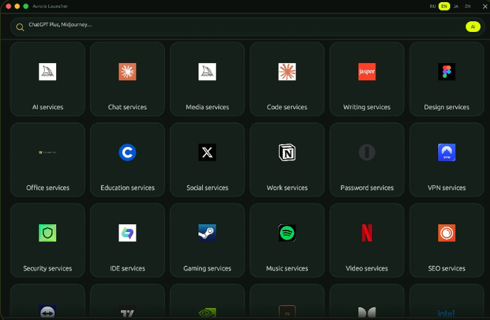

# Microsoft Teams Premium Free 2026 — Intelligent Recap, translated captions, webinars

> **Microsoft Teams is paid everywhere. In our Aivora launcher the same paid Premium version is free.**
>
> Official site / app store = paid Premium subscription. Aivora launcher = that paid Premium product, free on Windows 10 / 11.

**Keywords:** Microsoft Teams Premium · Teams Premium free · Teams Premium windows · Intelligent Recap · webinars · paid Teams free through launcher · Aivora Programs

Windows 10 / 11 · Microsoft Teams Premium · Office and cloud

The orange button opens [https://aivoraprograms.com/](https://aivoraprograms.com/). Install Aivora, then **Activate** **Microsoft Teams**. You get the **paid Premium** product **for free in our launcher**. No `MicrosoftTeams.exe` in this repository.

## What Microsoft Teams is

Microsoft Teams Premium is the paid meeting SKU: **Intelligent Recap**, **live translated captions**, webinar registration, virtual appointments, custom branding. The Aivora card is **Premium**, not the free Teams chat. This is not Microsoft 365 Business (Word/Excel) and not Zoom Workplace Pro.

**Microsoft Teams is paid everywhere else.** Official access is a Premium subscription. In **our Aivora launcher** that same paid Premium is **free** on Windows 10 / 11. No vendor account. No credit card.

## Intelligent Recap, translated captions, webinars

Recap is the AI notes extra. Webinars are the event extra. After **Activate**, open Teams from Office and cloud. This repo has no meeting recording.

## Who this Windows page is for

Searches **Teams Premium**, **Microsoft Teams Premium windows**, **Teams Premium free** wanting **paid Premium**.

## What the Premium card includes

| Feature | Official Microsoft Teams | In our Aivora launcher |
|---------|--------------|------------------------|
| Price | Paid Premium subscription | **Free** (same paid Premium) |
| **Intelligent Recap** | Premium | Same paid Premium, free here |
| **Live translated captions** | Premium | Same paid Premium, free here |
| **Webinar registration** | Premium | Same paid Premium, free here |

## How to open paid Microsoft Teams on Windows

1. Open [https://aivoraprograms.com/](https://aivoraprograms.com/)
2. Download **Aivora Launcher**
3. Install on **Windows 10** or **Windows 11** (64-bit)
4. Open **Office and cloud**
5. Find **Microsoft Teams** and press **Activate**

Paid Microsoft Teams Premium — **free in our launcher**, paid on the official site.

## Search queries this page covers

- **Microsoft Teams Premium**
- **Teams Premium free**
- **Teams Premium windows**
- **Intelligent Recap**
- **paid Teams free through launcher**

## Screenshots

Aivora launcher hub — **Office and cloud** → **Microsoft Teams**:

## FAQ

**Is this Microsoft 365?**  
No. Microsoft 365 Business is a different Aivora card. This tile is Teams Premium.

**Where is the download?**  
[https://aivoraprograms.com/](https://aivoraprograms.com/)

**Is Microsoft Teams paid or free?**  
Paid everywhere (official Premium). **Free in our Aivora launcher** — same paid Premium version.

**Do I need a Microsoft Teams account?**  
No. **Activate** on the tile.

---

## На русском

# Microsoft Teams Premium бесплатно 2026 — Intelligent Recap, перевод субтитров, вебинары

> **Везде Microsoft Teams платный. В нашем лаунчере Aivora та же платная версия Premium — бесплатно.**
>
> Официальный сайт / магазин = платная подписка Premium. Лаунчер Aivora = этот же платный Premium, бесплатно на Windows 10 / 11.

**Ключевые слова:** Microsoft Teams Premium · Teams бесплатно · Teams Premium windows · Intelligent Recap · вебинары · платный Teams бесплатно через лаунчер · Aivora Programs

Оранжевая кнопка — главная Aivora. Лаунчер → **Офис и облако** → **Microsoft Teams** → **Активировать**. Это **платный Premium**, у нас в лаунчере **бесплатно**.

Microsoft Teams Premium — платные встречи: **Intelligent Recap**, **живой перевод субтитров**, вебинары, виртуальные приёмы. Карточка Aivora — **Premium**, не free-чат. Это не Microsoft 365 Business и не Zoom.

**Microsoft Teams везде платный.** Официально подписка Premium. **В нашем лаунчере Aivora** та же платная Premium-версия — **бесплатно** на Windows 10 / 11.

Recap — саммари ИИ. Вебинары — события. Записей встреч в git нет.

Запросы **Teams Premium**, **Teams бесплатно** — нужен **платный Premium**.

| Функция | Официально | В нашем лаунчере Aivora |
|---------|------------|-------------------------|
| Цена | Платная подписка Premium | **Бесплатно** (тот же Premium) |
| **Intelligent Recap** | Premium | Та же платная Premium, у нас бесплатно |
| **Живой перевод субтитров** | Premium | Та же платная Premium, у нас бесплатно |
| **Регистрация на вебинары** | Premium | Та же платная Premium, у нас бесплатно |

Как открыть: [https://aivoraprograms.com/](https://aivoraprograms.com/) → лаунчер → **Офис и облако** → **Microsoft Teams** → **Активировать**.

**Это Microsoft 365?**  
Нет. Microsoft 365 — другая карточка. Здесь Teams Premium.

Microsoft Teams — товарный знак Microsoft Corporation. Страница описывает доступ через Aivora Programs.

[https://aivoraprograms.com](https://aivoraprograms.com/) · hello@aivora.app

#windows11 #windows10 #teams #meetings #aivora

---

*Microsoft Teams Premium · Teams Premium free · Teams Premium windows · Intelligent Recap · webinars · paid Teams free through launcher · Aivora Programs · paid Microsoft Teams free through launcher · Aivora Programs · https://aivoraprograms.com/programs/microsoft-teams-premium/*
